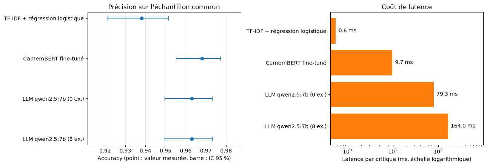

# 🎬 Analyse de sentiment : TF-IDF, CamemBERT ou LLM local ?

> Comparaison de trois approches de classification de critiques de films en français, sur
> l'accuracy **et** sur ce qu'elles coûtent : temps d'entraînement, latence, taille du modèle,
> matériel nécessaire. L'objectif est de savoir à partir de quand un modèle plus lourd se justifie.

<!-- 📸 Ajouter ici le graphique de comparaison généré par le notebook 03
     (enregistrer la figure dans assets/comparaison.png) :
      -->


---

## 🧠 En bref

Trois approches, une même tâche (critique positive ou négative), un même jeu de données :

| Approche | Principe | Entraînement |
|---|---|---|
| **TF-IDF + régression logistique** | Vecteurs de mots et de paires de mots, classifieur linéaire | 29 s sur CPU |
| **CamemBERT fine-tuné** | Transformer français pré-entraîné, ajusté sur la tâche | 19 min sur GPU |
| **LLM local en zero-shot / few-shot** | Qwen2.5-7B exécuté via Ollama, guidé par une consigne | Aucun |

**Ce que montre l'étude, en trois phrases.** CamemBERT fine-tuné est la plus précise des trois
(97,1 % sur le test complet, contre 94,5 % pour la baseline). Un LLM de 7 milliards de paramètres,
sans aucun entraînement, atteint 96,3 % sur un échantillon de 1 000 critiques : nettement mieux
que la baseline, et statistiquement indiscernable de CamemBERT à cette taille d'échantillon, mais
à une latence 8 à 17 fois supérieure. Fournir 8 exemples au LLM n'améliore pas sa précision et
double sa latence.

---

## 📋 Sommaire

- [Protocole](#-protocole)
- [Résultats](#-résultats)
- [Guide de décision](#-guide-de-décision)
- [Ce que l'analyse d'erreurs révèle](#-ce-que-lanalyse-derreurs-révèle)
- [Limites](#️-limites)
- [Installation et reproduction](#-installation-et-reproduction)
- [Structure du projet](#-structure-du-projet)
- [Dataset](#️-dataset)
- [Pistes d'amélioration](#-pistes-damélioration)
- [Stack technique](#️-stack-technique)

---

## 🔬 Protocole

Une comparaison n'a de valeur que si elle est équitable. Les choix suivants visent à le garantir :

- **Découpage officiel conservé** (160 000 critiques d'entraînement, 20 000 de validation,
  20 000 de test), pour que les résultats restent comparables à ceux publiés pour ce corpus.
- **Jeu de test utilisé une seule fois**, pour l'évaluation finale. Les choix de réglage
  (régularisation de la baseline, meilleure epoch de CamemBERT) se font sur le jeu de validation.
- **Deux évaluations complémentaires.** La baseline et CamemBERT sont évalués sur les 20 000
  critiques de test. Le LLM, plus lent à interroger, est évalué sur un échantillon aléatoire fixe
  de 1 000 critiques du test ; les trois approches sont comparées entre elles **sur ce même
  échantillon**.
- **Incertitude quantifiée.** Chaque accuracy est accompagnée d'un intervalle de confiance de
  Wilson à 95 %, et les écarts entre approches sont testés avec un test de McNemar exact, qui
  ne considère que les critiques sur lesquelles deux modèles divergent.
- **Exemples du prompt tirés du jeu d'entraînement**, jamais du test, équilibrés et mélangés.
- **Sortie du LLM déterministe** (température 0, graine fixe) : les résultats sont reproductibles
  à l'identique d'une exécution à l'autre.
- **Réponses non interprétables comptées comme des erreurs** pour le LLM, plutôt qu'ignorées
  (aucune n'a été observée sur cette tâche).
- **Latence mesurée dans les mêmes conditions** : prédictions unitaires (usage type API), modèle
  déjà chargé, médiane sur l'évaluation.

**Matériel de référence** : GPU NVIDIA GeForce RTX 5070 Ti (17,1 Go de VRAM), PyTorch 2.14.1
(CUDA 13.2), Windows.

## 📊 Résultats


| Approche | Accuracy (échantillon, n = 1 000) | Accuracy (test complet, n = 20 000) | Entraînement | Latence / critique | Taille |
|---|---|---|---|---|---|
| TF-IDF + régression logistique | 93,8 % [92,1 ; 95,1] | 94,5 % [94,1 ; 94,8] | 29 s (CPU) | 0,55 ms (CPU) | 15 Mo |
| CamemBERT fine-tuné | 96,8 % [95,5 ; 97,7] | 97,1 % [96,9 ; 97,4] | 19 min (GPU) | 10 ms (GPU) / 41 ms (CPU) | 445 Mo |
| Qwen2.5-7B, 0 exemple | 96,3 % [94,9 ; 97,3] | non évalué | aucun | 79 ms (GPU) | 4,7 Go |
| Qwen2.5-7B, 8 exemples | 96,3 % [94,9 ; 97,3] | non évalué | aucun | 164 ms (GPU) | 4,7 Go |

*Intervalles de confiance de Wilson à 95 % entre crochets. La taille du LLM est celle du modèle
quantifié (Q4_K_M, 7,6 milliards de paramètres) distribué par Ollama.*

### Les écarts sont-ils réels ?

Test de McNemar exact sur l'échantillon commun (nombre de critiques où seule l'une des deux
approches a raison) :

| Comparaison | Seule A juste | Seule B juste | p-value | Écart significatif |
|---|---|---|---|---|
| TF-IDF (A) vs CamemBERT (B) | 16 | 46 | 0,0002 | oui |
| TF-IDF (A) vs LLM 0 exemple (B) | 24 | 49 | 0,005 | oui |
| TF-IDF (A) vs LLM 8 exemples (B) | 25 | 50 | 0,005 | oui |
| CamemBERT (A) vs LLM 0 exemple (B) | 22 | 17 | 0,52 | non |
| CamemBERT (A) vs LLM 8 exemples (B) | 27 | 22 | 0,57 | non |
| LLM 0 exemple (A) vs LLM 8 exemples (B) | 10 | 10 | 1,0 | non |

Sur le test complet, l'avantage de CamemBERT sur la baseline est confirmé avec une très grande
marge : 797 critiques que seul CamemBERT classe correctement, contre 261 pour la seule baseline
(p < 10⁻⁶⁰), soit +2,7 points d'accuracy.

### Ce qu'on en retient

1. **Le fine-tuning rapporte 2,7 points sur la baseline**, de façon très nette, pour 19 minutes
   d'entraînement sur GPU. Le score de 97,1 % se situe à environ 0,3 point de la valeur de
   référence (97,44 %) publiée pour un modèle de type BERT français sur ce corpus.
2. **Un LLM sans entraînement rivalise avec le modèle spécialisé**, à la précision de mesure
   près : 96,3 % contre 96,8 % sur l'échantillon, écart non significatif. Cet écart de
   0,5 point est du même ordre que l'incertitude de la mesure (intervalles d'environ ±1 point).
3. **Les exemples dans le prompt n'apportent rien ici.** Zéro et huit exemples donnent la même
   accuracy (96,3 %), avec des prédictions qui divergent de façon symétrique (10 critiques
   dans chaque sens), mais la latence double (79 contre 164 ms), les exemples étant vraisemblablement
   retraités à chaque requête.
4. **L'écart de coût est considérable.** La baseline répond en 0,55 ms sur un simple CPU. Le LLM
   est environ 140 à 300 fois plus lent et occupe 4,8 Go de mémoire vidéo ; CamemBERT se place
   entre les deux (10 ms sur GPU, 41 ms sur CPU, soit environ quatre fois plus lent sans GPU).
5. **Le format de sortie du LLM est fiable sur cette tâche** : 100 % des réponses interprétables
   et aucune requête en échec sur 2 000 appels.

## 🧭 Guide de décision

- **Choisir la baseline TF-IDF** quand le volume est très élevé, que le matériel est modeste ou
  que la décision doit être explicable (les coefficients se lisent mot par mot). Elle laisse
  environ 2,7 points de précision sur la table par rapport à CamemBERT : à mettre en balance avec
  un coût d'inférence environ 18 fois plus faible (0,55 ms contre 10 ms) et aucun GPU requis.
- **Choisir CamemBERT fine-tuné** quand la précision prime et que des données annotées sont
  disponibles. Coût : un entraînement unique de 19 minutes et un modèle de 445 Mo ; la latence
  reste de quelques dizaines de millisecondes même sans GPU.
- **Choisir un LLM en zero-shot** quand aucune donnée annotée n'est disponible, que la tâche
  change souvent ou qu'un prototype est nécessaire immédiatement : la précision obtenue sans
  aucun entraînement est proche de celle du modèle spécialisé. Coût : une latence de plusieurs
  dizaines de millisecondes, plusieurs Go de mémoire vidéo, et l'absence d'explicabilité. Sur
  cette tâche, ajouter des exemples n'a pas de sens : même précision, latence doublée.

## 🔎 Ce que l'analyse d'erreurs révèle

CamemBERT commet 572 erreurs sur 20 000 critiques (2,9 %). Les cinq erreurs sur lesquelles il est
le plus sûr de lui (confiance de 100 %) sont toutes des critiques dont **le texte est négatif ou
ironique alors que le label du corpus est « positif »** : par exemple « Ce troisième volet de la
saga n'est pas franchement une réussite !! », ou une critique qui décrit un film « si mauvais
que ça en devient cosmique ». Dans ces cas, le modèle lit le texte de façon défendable : c'est
le label qui est discutable (note incohérente avec le texte, ou critique ironique du type
« nanar comme je les aime »).

Le même phénomène apparaît sur l'échantillon commun : 8 critiques sur 1 000 sont mal classées
par les quatre systèmes à la fois. Plusieurs sont de véritables critiques mitigées (un film
qui « a mal vieilli » tout en restant un chef-d'œuvre du burlesque, une série riche en action
mais jugée moins bonne que le premier volet). Ces cas donnent une idée du **plafond de précision réellement
atteignable** sur ce corpus : atteindre 100 % n'est pas un objectif réaliste, et les derniers
points de précision se jouent en partie sur du bruit d'annotation.

## ⚠️ Limites

- **Le LLM n'est évalué que sur 1 000 critiques.** Les intervalles de confiance sont de l'ordre
  de ±1 à 1,5 point : la comparaison LLM / CamemBERT ne permet pas de conclure à une différence.
  Évaluer le LLM sur le test complet (environ 30 minutes en zero-shot) serait plus concluant.
- **Contamination possible du LLM.** Allociné est public depuis des années ; Qwen2.5 en a
  peut-être vu des extraits pendant son pré-entraînement, ce qui pourrait gonfler son score. Seule
  une évaluation sur des critiques inédites permettrait de l'écarter.
- **Troncature à 256 tokens pour CamemBERT.** 12,7 % des critiques dépassent cette longueur
  (médiane de 95 tokens, 95e percentile à 346, maximum observé à 502, mesures sur un échantillon).
  Pour ces critiques, la fin du texte, qui contient souvent le verdict, n'est pas lue. L'effet
  sur le score n'a pas été mesuré.
- **Réglages peu explorés.** Le LLM est évalué avec un seul prompt, rédigé sans optimisation ;
  CamemBERT est entraîné avec une seule graine et des hyperparamètres standards ; la baseline
  n'est réglée que sur sa régularisation. Aucune des trois approches n'est poussée à son maximum.
- **Un seul LLM, quantifié.** La version non quantifiée ou un modèle plus gros donneraient
  d'autres résultats.
- **Latences propres à un matériel et un système.** Elles servent à comparer les approches entre
  elles, pas à prédire les performances sur une autre machine. Le surcoût des exemples dans le
  prompt (164 contre 79 ms) a été mesuré sur 1 000 requêtes séquentielles ; une mesure sur un très
  petit échantillon avait donné un résultat différent, ce qui illustre la sensibilité de ces
  mesures.
- **Une seule tâche, un seul corpus, deux classes.** Les conclusions ne se transposent pas telles
  quelles à d'autres langues, domaines ou tâches plus fines.

## 🚀 Installation et reproduction

Deux environnements sont recommandés : un environnement CPU léger pour le notebook 01, un
environnement GPU pour les notebooks 02 et 03.

```bash
git clone https://github.com/Nirvathec/allocine-sentiment-comparison.git
cd allocine-sentiment-comparison

# Notebook 01 (baseline, CPU)
pip install datasets scikit-learn pandas matplotlib joblib

# Notebooks 02 et 03 (GPU) : installer d'abord PyTorch avec CUDA (commande sur pytorch.org)
pip install transformers datasets scikit-learn scipy pandas matplotlib tqdm requests joblib ipywidgets charset-normalizer
```

**Pour le notebook 03**, installer [Ollama](https://ollama.com/download), puis télécharger le
modèle :

```bash
ollama pull qwen2.5:7b
```

Chaque notebook démarre avec `SMOKE_TEST = True` (petit sous-ensemble, exécution rapide) pour
vérifier que tout fonctionne. Le passer à `False` lance l'évaluation complète. Les résultats du
test rapide sont enregistrés sous un autre nom et ne se mélangent pas aux résultats définitifs.

Durées observées sur le matériel de référence : notebook 01 de l'ordre de quelques minutes,
notebook 02 environ 20 minutes (2 epochs de 10 minutes), notebook 03 environ 5 minutes pour
1 000 critiques en zero-shot et en few-shot.

## 📁 Structure du projet

```
allocine-sentiment-comparison/
├── README.md
├── 01_exploration_baseline.ipynb   # Exploration + TF-IDF et régression logistique
├── 02_finetune_camembert.ipynb     # Fine-tuning de CamemBERT (GPU)
├── 03_llm_fewshot_ollama.ipynb     # LLM local + comparaison finale
├── check_hardware.py               # Diagnostic CPU / GPU / CUDA / PyTorch
├── results/                        # Métriques (JSON, CSV) produites par les notebooks
├── models/                         # Modèles sauvegardés (non versionnés)
└── assets/                         # Graphiques pour ce README
```

## 🗂️ Dataset

[Allociné](https://huggingface.co/datasets/tblard/allocine) (Théophile Blard) : 160 000 critiques
d'entraînement, 20 000 de validation et 20 000 de test, étiquetées positives ou négatives (environ
50 % de chaque classe). La fiche du dataset n'indique pas de licence explicite : usage ici limité
à la recherche et à l'illustration, avec mention de l'auteur.

## 🔭 Pistes d'amélioration

- **Mesurer l'effet de la troncature** : réentraîner avec 512 tokens (couvre toutes les critiques
  observées) et comparer l'erreur selon la longueur des critiques.
- **Évaluer le LLM sur le test complet**, en zero-shot, pour une comparaison à trois sur 20 000
  critiques et des intervalles de confiance environ quatre fois plus étroits.
- **Plusieurs tailles de LLM** (Qwen2.5 3B, 7B, 14B) pour tracer la courbe précision / taille.
- **Sortie contrainte pour le LLM** : Ollama permet d'imposer un format de réponse (schéma JSON).
- **Fine-tuning léger du LLM (LoRA)** : combiner la compréhension d'un LLM avec une
  spécialisation à la tâche.
- **Modèle distillé** (DistilCamemBERT) ou export ONNX / quantification pour réduire la latence
  sans GPU.
- **Plusieurs graines** pour mesurer la variabilité de l'entraînement.
- **Évaluation sur des critiques inédites** pour lever le doute sur la contamination.

## 🛠️ Stack technique

- **Modèles** : scikit-learn (TF-IDF, régression logistique), PyTorch et Transformers (CamemBERT),
  Ollama (Qwen2.5-7B)
- **Évaluation** : intervalles de Wilson, test de McNemar exact (SciPy)
- **Visualisation** : Matplotlib
- **Données** : Hugging Face Datasets

---

*Projet réalisé dans le cadre de mon portfolio en data science et NLP.*
*N'hésite pas à me contacter pour toute question : vergne.clement49@gmail.com*
